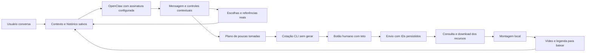

# Arquitetura e migração do Estúdio

18/10/2026. Implementação sobre o sistema enviado pelo usuário, não uma nova pasta de recomendações.

## O produto pedido

Uma conversa que conduz a produção. O usuário descreve a ideia; a IA abre quiz, galeria de movimento, seletor de imagens, estrutura ou edição conforme faltar uma decisão. O formulário de pilares, as avaliações e as métricas não fazem parte do fluxo ativo. A geração de vídeo é uma ação financeira concreta: só o botão humano com cotação real a executa.

A interface é composta por blocos tipados retornados no JSON da IA, com dados validados pelo servidor. O conteúdo, a ordem e o momento dos controles mudam com a conversa. A IA não injeta JavaScript/HTML arbitrário no computador. A resposta chega ao fim do turno do OpenClaw; não há streaming parcial de um JSON ainda incompleto.

## O que foi aproveitado

| Base recebida | Uso na versão atual |
|---|---|
| Python/FastAPI `studio/server.py` | Servidor, arquivos da biblioteca, extrator de quadros e função de acesso à ponte |
| `studio/assistente.py` | Extração de quadros, folhas numeradas e leitura do JSON de resposta |
| Pastas persona/base/peças/cenários/movimentos/saída | Mesma organização física; os arquivos antigos podem ser copiados sem renomear |
| Ponte Node `studio/mcp/src/openclaw.ts` | Gateway local, assinatura configurada, anexos e sessões de chat |
| MCP original | Transporte HTTP/stdio preservado, nova superfície de oito ferramentas de produção |
| React/Vite | Mesma aplicação/dependências, entrada reorganizada como chat e componentes contextuais |
| Geração Atlas/editor/projetos/avaliações anteriores | Código e arquivos preservados para compatibilidade; não são o caminho ativo do chat |

O ZIP recebido permaneceu intacto. Seu SHA256 é `77e5d0f2fa4cea33ad24580bfa67b31c1646adde724246e9e0ab47707bafd87e`. A lista de arquivos alterados/adicionados é produzida em `MANIFESTO_MUDANCAS.json`. Não foram migradas credenciais ou dados de conta; o ZIP original não continha `.env` nem registros pessoais de execução.

## Componentes novos

- `studio/processo.py`: contexto, plano, conversa, seleção de mídia, cotação, autorização, recuperação e edição. A mesma produção permanece ao longo da conversa.
- `studio/producao_store.py`: SQLite com escrita transacional, revisão otimista e eventos. Uma janela desatualizada não sobrescreve um plano novo. Operações concorrentes na mesma produção são bloqueadas.
- `studio/dreamina.py`: adaptador da CLI oficial. Descobre catálogo real, salva rascunhos, cota, confirma um teto humano, envia com IDs estáveis e baixa recursos.
- `studio/montagem.py`: FFprobe, preparação de movimento com margens, cortes, comparação e tipografia. Não usa provedor de geração.
- `studio/processo-prompt.md`: contrato de resposta da IA e decisões criativas atuais. O contexto real e a conversa recente são enviados a cada turno; não depender somente da memória de uma sessão externa.
- `studio/web/src/components/*Conversa*` e `CartaoProducao.tsx`: seletores, modais, estrutura, quiz, orçamento, edição e resultado.
- `studio/mcp/src/processo-ferramentas.ts`: oito ferramentas sem geração paga nem avaliações. O MCP antigo ficou no código, sem registro no novo servidor.

## Fluxo de execução

A conversa não exige percorrer esse diagrama como sete telas. Por exemplo, um vídeo pronto pode entrar diretamente na edição local. O piloto pode cotar só a transformação; o verão fica para depois. Quando todas as tomadas enviadas estiverem baixadas, a composição é local; falhas de montagem preservam os brutos.

## Orçamento e recuperação

1. As referências de imagem e vídeo são validadas antes da cotação. O catálogo vivo determina modos, durações e referências suportadas.
2. Só o trecho necessário do vídeo de movimento é preparado. A margem 9:16 evita a proporção estreita recusada no V7, sem esticar a imagem.
3. O plano e os arquivos geram uma assinatura de conteúdo; mudança de prompt, imagem ou modelo invalida a cotação. Mudar texto/corte da edição não exige gerar novamente.
4. A cotação precisa cobrir todas as tomadas selecionadas. A versão do canvas e o preço são conferidos novamente antes de confirmar.
5. A autorização humana, reserva e IDs de envio são salvos ANTES do comando que pode consumir créditos.
6. Timeout depois de enviar vira `envio_incerto`; consultar a operação original é o único caminho automático. Sem repetir POST com novo ID.
7. Falhas não zeram custos presumindo estorno. Crédito registrado no recurso e reserva não liquidada permanecem separados.
8. O token de confirmação fica apenas em memória e só é entregue ao comando de execução correspondente. Não entra no banco, logs ou arquivo exportado.
9. Downloads usam arquivo temporário e só passam a ser uma tomada local após FFprobe e duração coerente. Falha de download repete a obtenção do MESMO recurso, sem gerar.

A versão inicial opera com **um processo Python**, como o lançador fornecido. Não configurar múltiplos workers: o bloqueio de operações em andamento usa memória do processo, embora a persistência seja transacional. Não expor estas portas na internet. O cabeçalho do botão de geração separa a superfície do aplicativo da MCP; ele não é autenticação de identidade humana contra outro programa local malicioso.

## Migração do sistema antigo

1. Mantenha a pasta antiga e o ZIP. Extraia a versão nova em outra pasta definitiva.
2. Copie as mídias que deseja reaproveitar para as mesmas pastas. Não é necessário importar avaliações, pilares ou metas.
3. O banco novo não sobrescreve projetos/receitas/registros antigos. Os formatos antigos permanecem como origem consultável.
4. A retomada automática de Atlas foi desativada no início. Ela só volta se alguém configurar explicitamente `ESTUDIO_RETOMAR_ATLAS_LEGADO=1`; não é necessária neste fluxo.
5. O novo chat não lê a chave Atlas nem exige `.env` para abrir. `.env.example` contém somente opções da ponte/CLI.
6. Registre o agente separado `ellie-studio` com o helper. Ele não substitui outro agente `ellie` nem seu modelo de assinatura.

## Limites reais desta entrega

A ponte e o transporte MCP foram testados; o Gateway com a assinatura do usuário não estava configurado neste ambiente. Os testes de conversa usam respostas simuladas para validar contexto, quiz e falhas; não fingem autenticação real. Nenhuma nova geração paga foi usada para testar o adaptador.

Imagens integradas ao chat continuam dependendo da ferramenta disponível no host. Aqui o caminho implementado é receber a imagem criada no chat pela biblioteca. Não foi criada uma API escondida para reproduzir a ferramenta integrada do ChatGPT a partir do OpenClaw.

O exemplo contém fontes já prontas e permite verificar a edição sem esses acessos. A qualidade de um próximo vídeo só pode ser conhecida depois de gerá-lo; não há garantia de transferência exata de coreografia ou viralização.

Atualização da conexão: em 18/10/2026, o login OAuth Codex e a resposta real pelo agente `ellie-studio` foram confirmados neste PC. Uma conversa do aplicativo também foi persistida sem erro. O registro foi feito por RPC oficial com permissão administrativa pontual; a ponte diária continua com leitura/escrita. Consulte `VALIDACAO.md` para tempos observados e limites. As credenciais continuam fora do pacote e do GitHub.
